# Usage-based licensing (UBL) rendering

How to set up third-party usage-based licensing (UBL) on a Deadline farm, with the snags hit along
the way.

## Requirements

1. [Set the Deadline repository up with RCS and secrets enabled](#1-set-up-the-repository-with-rcs-and-secrets)
2. [Buy third-party render time from the Thinkbox Marketplace](#2-buy-render-time-from-the-thinkbox-marketplace)
3. [Download the third-party licensing certificates](#3-download-the-third-party-licensing-certificates)
4. [Decide where the License Forwarder runs](#4-decide-where-the-license-forwarder-runs)
5. [Install and configure the License Forwarder](#5-set-up-the-license-forwarder)
6. [Set up Deadline Limits for UBL and use them on jobs](#6-set-up-deadline-limits-for-ubl)
7. [Add your Marketplace UBL URL and activation code to the repository](#7-add-your-ubl-url-and-activation-code-to-the-repository)
8. [Assign roles to your nodes with Manage Identities](#8-assign-roles-with-manage-identities)
9. [Monitor your usage](#9-monitoring)

> [!IMPORTANT]
> If the Deadline repository installer reports any error about secrets management, adding your
> UBL details to the repository will probably fail silently, with no error.
>
> Your Deadline super-user admin is not the same as the secrets-management admin. Fix it with
> [deadlinecommand](https://docs.thinkboxsoftware.com/products/deadline/10.1/1_User%20Manual/manual/secrets-management/deadline-secrets-management.html),
> then check the UBL URL is in the secrets manager (see [step 7](#7-add-your-ubl-url-and-activation-code-to-the-repository)).

## 1. Set up the repository with RCS and secrets

- [Installing Deadline with the RCS](https://docs.thinkboxsoftware.com/products/deadline/10.1/1_User%20Manual/manual/aws-portal-installing.html#aws-portal-install-rcs-detail-label)
- Add the RCS to the Launcher menu with a line in `deadline.ini`
  ([client configuration](https://docs.thinkboxsoftware.com/products/deadline/10.1/1_User%20Manual/manual/client-config.html)).
- [Start the RCS](https://docs.thinkboxsoftware.com/products/deadline/10.1/1_User%20Manual/manual/aws-portal-remote-connection-server.html#aws-portal-how-to-start-rcs-ref-label)

## 2. Buy render time from the Thinkbox Marketplace

The steps are laid out on the [Thinkbox Marketplace](https://marketplace.thinkboxsoftware.com/).

After the initial setup you receive an email with your unique URL and activation code. They are
also in the [Thinkbox customer portal](https://thinkbox.flexnetoperations.com/).

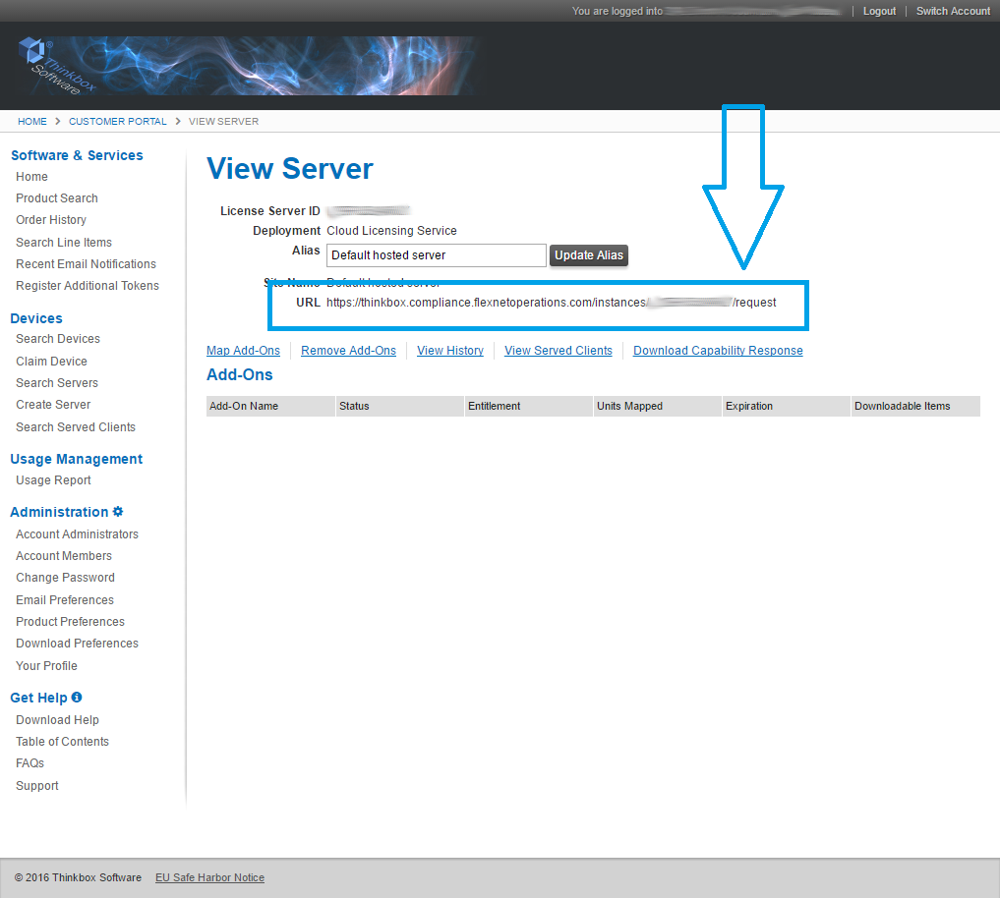

You may have several line items (C4D, Redshift and so on). Look for **Enable License Usage**:

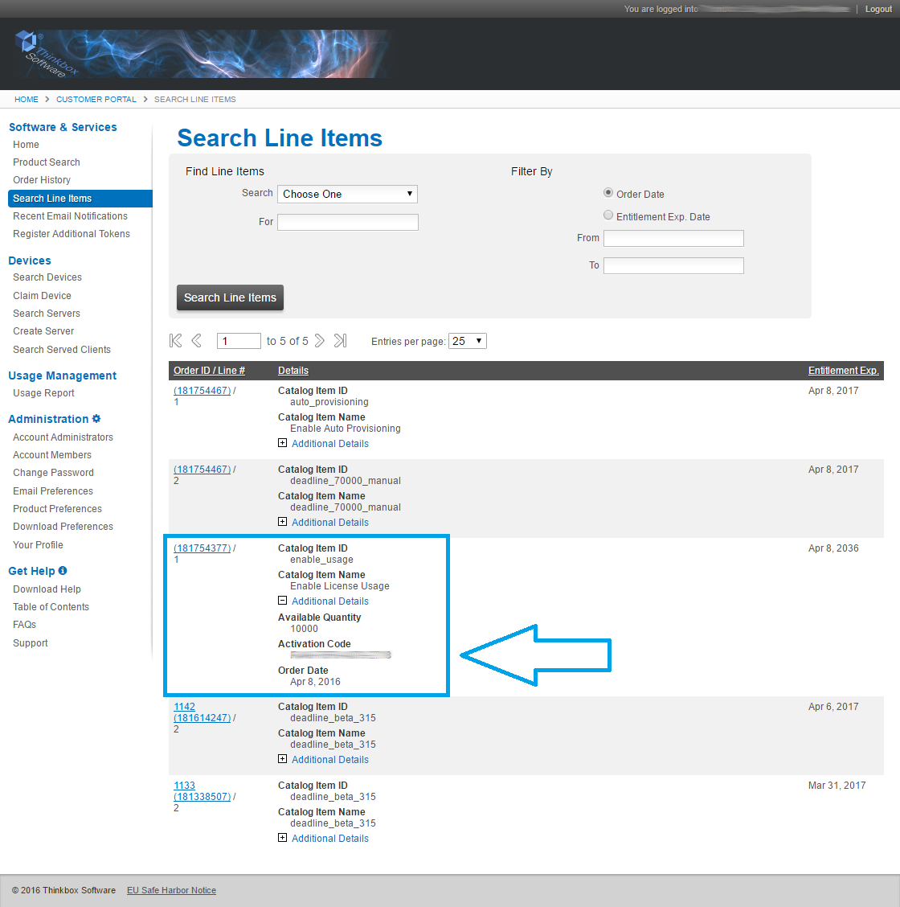

## 3. Download the third-party licensing certificates

1. Go to the [Thinkbox customer portal](https://thinkbox.flexnetoperations.com/) and sign in.
2. Choose **Home** in the left navigation pane.
3. Choose **Certificates**.

   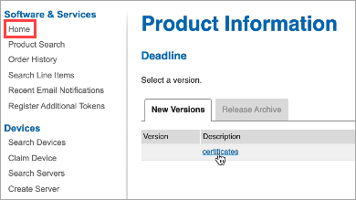

4. In the **File Name** section, download the UBL certificates zip.

   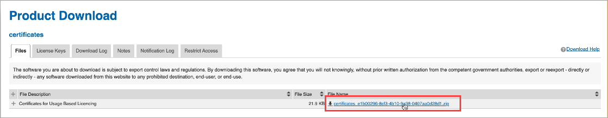

## 4. Decide where the License Forwarder runs

In **Configure Repository Options > Usage Based Licensing**, the **Enable Web Forwarding** and
**Auto-detect 3rd Party Usage Based License Consumption** settings decide where the License
Forwarder has to run.

- **Both unchecked** (what worked here): run the License Forwarder on each render node.
- **Checked:** run the License Forwarder on the RCS machine. Deadline sets up a port forward on the
  render node, which conflicts with a forwarder running there and breaks it.

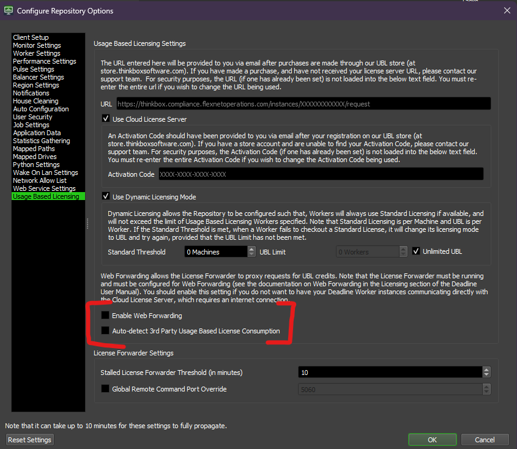

## 5. Set up the License Forwarder

> [!TIP]
> The certificate installer can run on any machine, including the render node; it does not have
> to be the RCS machine. With the settings above unchecked, do this on every node and run a
> forwarder on each one.

1. **Run the certificate installer with the Forwarder install type.**

   This generates the certificates the node uses to reach the RCS over SSL for secrets
   management. Enter the hostname or IP of the machine you are installing on: the render node's
   IP, or the RCS machine's if the forwarder runs there (not advised).

   You can enter a hostname, but in practice the forwarder then fails to find the certificates
   because it looks for one issued to an IP. To use a hostname, override it in the **License
   Forwarders** panel in Monitor, which makes it pick up the certificate. Do this **after** the
   next step.

   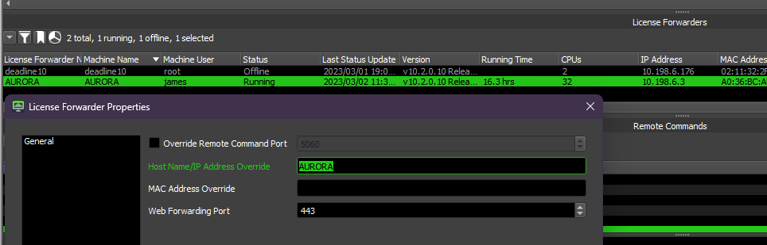

2. **Run the certificate installer with the
   [Worker install type](https://docs.thinkboxsoftware.com/products/deadline/10.1/1_User%20Manual/manual/licensing-web-forwarding.html#setup-workers).**

   It asks for the location of the certificates generated in step 1, then installs them as system
   root certificates.

3. **Copy the UBL certificates** downloaded from the portal to a folder the License Forwarder can
   read. A `certs_UBL` folder inside the repository keeps them in one place; a local folder in the
   Deadline install also works.

   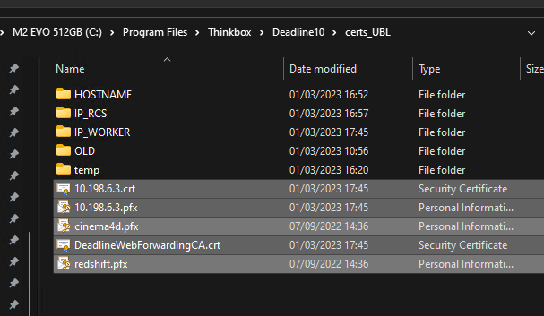

4. **Point the License Forwarder at those certificates**, either on the command line:

   ```
   deadlinelicenseforwarder.exe -sslpath C:\repo\certs_UBL
   ```

   or with [`LicenseForwarderSSLPath`](https://docs.thinkboxsoftware.com/products/deadline/10.1/1_User%20Manual/manual/client-config.html#licenseforwardersslpath)
   in `deadline.ini`.

5. **Optional `deadline.ini` settings** to show the forwarder in the Launcher menu, start it at
   login and restart it if it crashes
   ([client configuration](https://docs.thinkboxsoftware.com/products/deadline/10.1/1_User%20Manual/manual/client-config.html#includelicenseforwarderinlaunchermenu)):

   ```ini
   IncludeLicenseForwarderInLauncherMenu=True
   LaunchLicenseForwarderAtStartup=True
   KeepLicenseForwarderRunning=True
   ```

## 6. Set up Deadline Limits for UBL

- In Monitor, add a **Limits** panel.
- Add a new **License Limit**. The name can be anything; the UBL application is chosen inside the
  limit.
- Pick the limit when submitting a job, or add it to an existing job in Monitor.

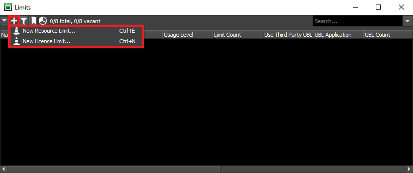

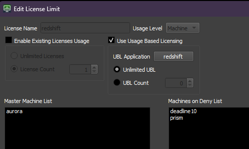

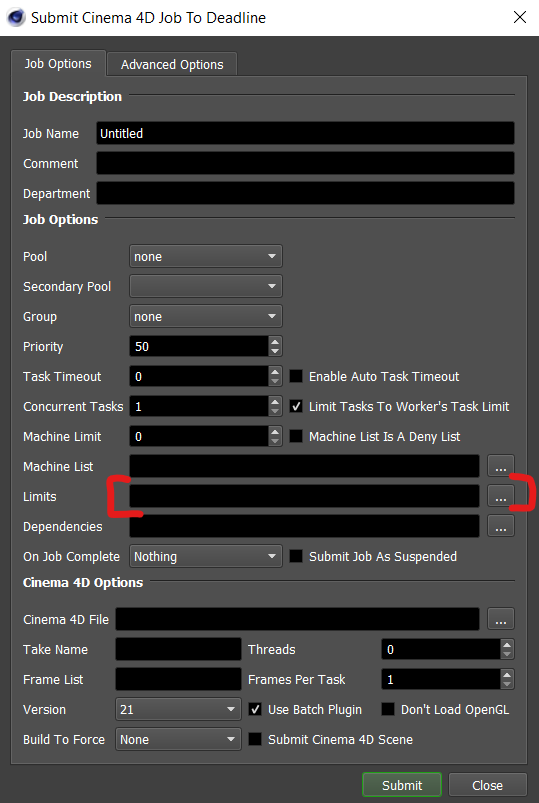

## 7. Add your UBL URL and activation code to the repository

1. In Monitor, choose **Tools > Super User Mode**.
2. Choose **Tools > Configure Repository Options**.
3. In the left pane, choose **Usage Based Licensing**.
4. Enter the licence server URL in **URL** and the activation code in **Activation Code**. These
   are the details emailed to you in [step 2](#2-buy-render-time-from-the-thinkbox-marketplace).
5. Check they reached Deadline secrets:

   ```
   ./deadlinecommand.exe secrets ListAllSecrets <yourDeadlineSuperUserAdminID>
   ```

   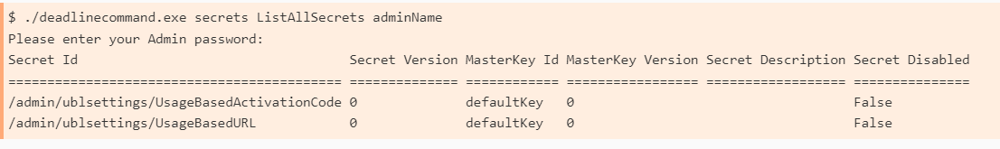

## 8. Assign roles with Manage Identities

Use [Manage Identities](https://docs.thinkboxsoftware.com/products/deadline/10.1/1_User%20Manual/manual/secrets-management/deadline-secrets-management.html)
in Monitor. With many nodes, set up registration rules to assign identities automatically.

Without this step a node cannot complete the handshake with the RCS, so it cannot prove its
identity to reach your cloud UBL licence server and draw credits.

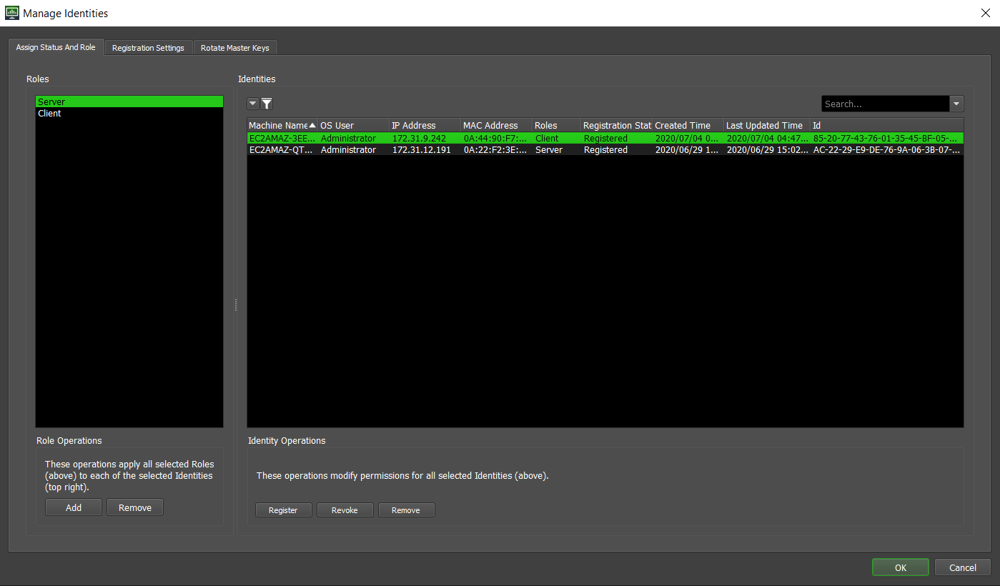

## 9. Monitoring

Check usage in the [Thinkbox customer portal](https://thinkbox.flexnetoperations.com/).

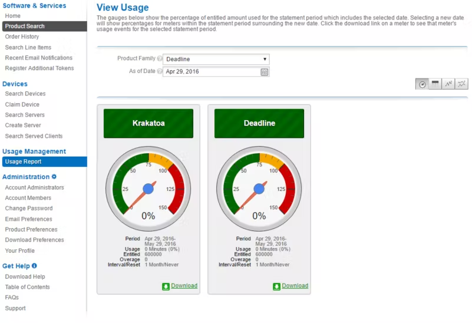
